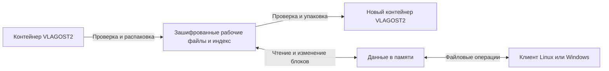

# Архитектура vault-lab 0.1.0

Проект — хранилище зашифрованных контейнеров с FUSE-интерфейсом и отдельным
консольным клиентом в режиме `open`. Платформа: Linux x86-64.

## Архитектура VLAGOST2

В Linux сеанс запускается из CLI. FUSE предоставляет доступ к данным, расшифрованным в памяти по запросу. Проект Windows SD-Reader использует ту же раскладку контейнера.

Изменения фиксируются в рабочей копии. Исходный контейнер заменяется после
проверки новой упаковки. [Сценарий работы](SBOX_WINDOWS_READER.md#общий-сценарий-работы-в-linux-и-windows)

## Карта исходников

| Файл | Назначение |
|---|---|
| `src/main.rs` | CLI, десятичные квоты, скрытый ввод ключа и отключение core dumps |
| `src/cipher.rs` | Криптоплагин, KDF, CBC и HMAC |
| `src/format.rs` | Двоичный контейнер, индекс, проверка дерева и контекст блока |
| `src/store.rs` | Блокировка, рабочие файлы, чтение и обновление блоков, упаковка и восстановление |
| `src/store/journal.rs` | Зашифрованные контрольные снимки, изменения индекса и мелкие синхронные правки |
| `src/session.rs` | Монтирование, пространство имён и завершение сеанса |
| `src/fs.rs` | FUSE-операции над деревом и зашифрованными рабочими файлами |
| `src/probe.rs` | Консольный клиент с открытым дескриптором корня |
| `src/safe_path.rs` | Открытие путей с ограничениями `openat2` |

Дерево с именами, размерами и тегами блоков хранится в памяти. Содержимое
файлов читается из рабочего каталога по блокам. FUSE обрабатывает запросы
последовательно, а блокировка рядом с контейнером сериализует сеансы утилиты
для одного пути. [Модель угроз](SECURITY.md)
