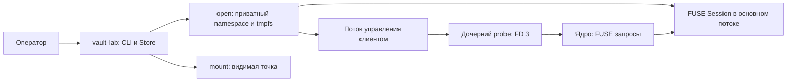

# FUSE, процессы и семантика файлов

Файловые операции используют зашифрованную рабочую копию `VLAGOST2`.
При чтении нужные блоки проверяются и расшифровываются в памяти.
Упаковка выполняется после штатного размонтирования.
[Общий сценарий](SBOX_WINDOWS_READER.md#общий-сценарий-работы-в-linux-и-windows)

## Режимы сессии

VaultFs заимствует Store на время монтирования. FUSE-обработчики используют `&mut self`;
приложение не реализует параллельные записи с конфликтующим commit.
Поток управления в open открывает корневой FD, запускает дочерний процесс,
ждёт его и выполняет размонтирование. Основной поток обслуживает Session::run.

Перед exec выполняются dup2 в FD 3, очистка close-on-exec, восстановление
SIGINT по умолчанию для клиента и установка `PR_SET_PDEATHSIG=SIGKILL`.
Родитель в open игнорирует SIGINT. При штатном выходе клиента родитель
размонтирует FUSE и пакует контейнер. При ошибке или аварии зафиксированные
изменения остаются в рабочей папке до повторного открытия.

В режиме mount отдельный поток раз в 100 мс проверяет флаг SIGINT/SIGTERM
и вызывает unmounter. При занятой точке выводится ошибка; можно закрыть файлы
и повторить Ctrl-C. При выходе обработчики сигналов восстанавливаются.

## Поддерживаемые операции

| FUSE callback | Семантика |
|---|---|
| lookup / getattr | Поиск узла и синтетические атрибуты |
| mkdir / create | Новый inode и фиксация рабочего индекса |
| open / release | Учёт числа открытий файла в памяти |
| read | Расшифровка запрошенных блоков. За концом файла возвращается пустой ответ |
| write | До восьми изменённых блоков по 1 МБ на сеанс. Соседние блоки одного файла фиксируются группой. Запись за концом файла с разрывом сразу материализует промежуток |
| setattr(size) | Усечение или нулевое расширение рабочего файла |
| readdir | `.` / `..` и дочерние узлы с offset |
| unlink / rmdir | Удаление с проверкой типа, открытий и пустоты |
| rename | Перенос и переименование, включая режим `RENAME_NOREPLACE` |
| flush / fsync | Запись и синхронизация остатка для указанного файла |

Файловый handle равен inode. `opened` не сохраняется на диск. Удаление открытого
файла возвращает EBUSY; обычная POSIX-семантика unlink открытого файла отсутствует.
При создании и открытии выставляется DIRECT_IO. TTL атрибутов равен нулю.

## Атрибуты и ошибки

Права фиксированы: каталоги 0700, файлы 0600. Времена — UNIX_EPOCH, а не время
последней записи. Изменение mode/uid/gid/flags через setattr отвергается
EOPNOTSUPP. Переданные времена отдельно не сохраняются. Размер блока атрибутов
4096, число 512-байтных блоков вычисляется из размера данных.

| Ошибка | Пример причины |
|---|---|
| ENOENT | Узел отсутствует |
| EINVAL | Неверное имя или offset |
| EEXIST | Имя уже занято |
| ENOTDIR / EISDIR | Неподходящий тип узла |
| ENOTEMPTY | Удаление непустого каталога |
| EBUSY | Файл открыт |
| ENOSPC | Ограничение размера индекса или исчерпан счётчик inode |
| EFBIG | Превышена квота или переполнено смещение |
| EIO | Ошибка commit или обращение к poisoned Store |

Ссылки, mmap, xattr, POSIX-блокировки и особые флаги rename, кроме
`RENAME_NOREPLACE`, выходят за рамки прототипа. Замена открытого файла при
переименовании возвращает EBUSY. Размер файла учитывает данные в буфере
до их фиксации. Чтение видит текущую версию каждого блока в памяти. При заполнении кэша
служба фиксирует блоки одного файла. `flush`, `fsync` и закрытие фиксируют
записи указанного файла. `O_SYNC` и `O_DSYNC` дожидаются фиксации до
ответа на запись. Штатное завершение фиксирует все файлы. До синхронизации
авария может привести к потере до 8 МБ принятых данных. Квота учитывает
изменения размеров всех файлов с буферизованными записями.
